# QoS Traffic Management System — SDN + UDP Sockets

**Computer Networks (UE25CS243A) · SDN-Socket Programming, Jackfruit Mini Project · Project 5**

| | |
| --- | --- |
| **Project** | 5 — QoS Traffic Management System |
| **Protocol** | UDP |
| **Team** | Yug Gajera · Shubh Srivastava · Anusha Kiran Vasisht |

---

## 1. Summary

We built a small emulated network where three kinds of traffic share one slow link: **voice**, **video** and **bulk** (a big file transfer). When the link gets overloaded, our SDN controller notices within about 3 seconds and gives voice and video priority. They keep working; bulk slows down.

**Main result (on the course VM):**

- **Without our system,** voice and video lost about **47%** of their packets and were delayed about **360 ms**.
- **With our system,** they lost **0%** and were delayed about **2 ms**.

---

## 2. The problem and what we had to do

**The problem:** build a UDP application that creates different types of traffic, and use SDN to give important traffic priority when the network is congested.

| The brief asked us to… | What we did |
| --- | --- |
| Create several UDP traffic types | Three senders: voice (0.5 Mbps), video (3 Mbps), bulk (20 Mbps) |
| Tell the traffic types apart | Each type uses its own UDP port: 5001, 5002, 5003 |
| Give priority using SDN | The controller puts each type in its own queue on the switch |
| Create congestion on purpose | 23.5 Mbps of traffic is sent into a 10 Mbps link |
| Measure throughput, delay and loss | The receiver measures all of these for each type |
| Check fairness | Jain's fairness index, calculated for each test |
| Change the policy while running | Automatic switch on congestion, plus live commands |

---

## 3. How the system is built

**Simple picture:** think of a highway that narrows to a one-lane bridge. Too many cars arrive at once, so there is a queue. Our system gives voice and video their own priority lanes over the bridge, so a traffic jam of bulk trucks can't block them.

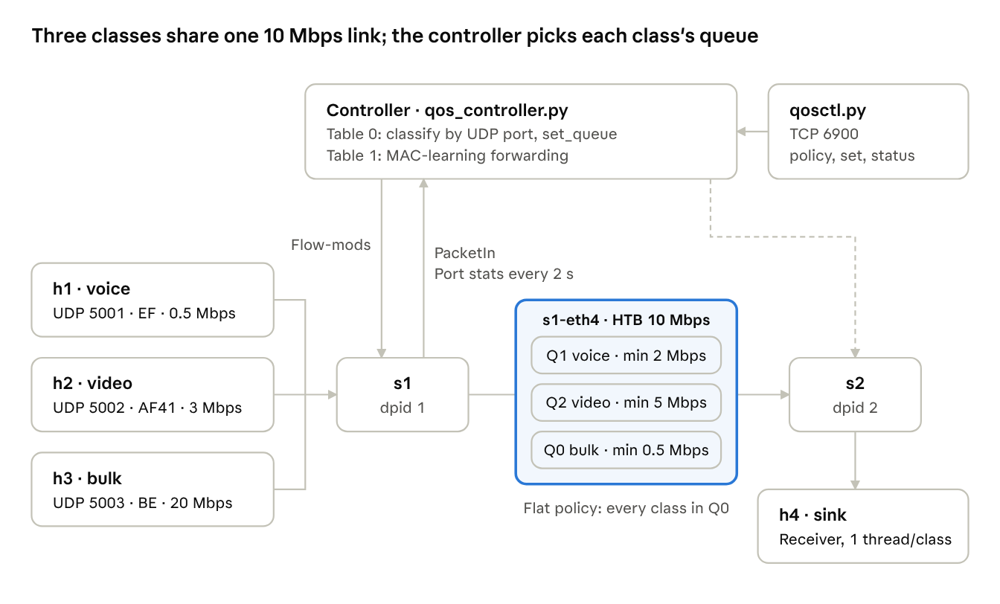

### The parts

| Part | What it is | Its job |
| --- | --- | --- |
| **Mininet** | A program that creates a fake network inside one computer | Gives us hosts h1–h4 and the links between them |
| **Open vSwitch** (s1, s2) | A software network switch | Forwards packets and **enforces** the queues |
| **SDN controller** (`qos_controller.py`) | The "brain", running on OS-Ken | **Decides** which queue each traffic type uses |
| **Senders** (`udp_sender.py`) | Programs on h1, h2, h3 | Create voice, video and bulk traffic |
| **Receiver** (`udp_receiver.py`) | Program on h4 | Measures speed, loss, delay and jitter |
| **`qosctl.py`** | A small command tool | Lets us change the controller's policy live |

**Key idea:** the controller **decides**, the switch **enforces**.

### The three traffic types

| Type | Sent from | UDP port | How much it sends | Its queue | Guaranteed speed | Priority |
| --- | --- | ---: | ---: | ---: | ---: | --- |
| Voice | h1 | 5001 | 0.5 Mbps | 1 | 2 Mbps | Highest |
| Video | h2 | 5002 | 3 Mbps | 2 | 5 Mbps | Middle |
| Bulk | h3 | 5003 | 20 Mbps | 0 | 0.5 Mbps | Lowest |

The link between s1 and s2 can carry only **10 Mbps**, but together the three send **23.5 Mbps**. So once bulk starts, the link is overloaded. That is the congestion we test.

---

## 4. How it works, step by step

1. **Start-up.** The controller starts and both switches connect to it.
2. **Queues are created.** On the slow link (port `s1-eth4`) Open vSwitch makes three queues, one per traffic type, each with a guaranteed speed and a priority.
3. **Traffic is recognised.** The controller puts a rule in the switch for each UDP port: "port 5001 = voice, send it to queue X". This happens in **table 0** of the switch.
4. **Traffic is forwarded.** A second set of rules, in **table 1**, sends each packet towards the right host (normal learning-switch forwarding).
5. **The controller watches the link.** Every **2 seconds** it asks the switch how much data went over the slow link.
6. **Congestion: switch to priority.** If the link is **80% or more** full, the controller changes the table-0 rules: voice → queue 1, video → queue 2, bulk → queue 0. This is the **qos** policy.
7. **Back to normal.** When the link drops to **60% or less**, it puts all traffic back in queue 0. This is the **flat** policy (one shared queue).

**Why two numbers (80% and 60%)?** With only one number, the policy would flip back and forth every 2 seconds when traffic sits near it. The gap stops that. This is called **hysteresis**.

**Why two tables?** Changing the policy only rewrites three rules in table 0. The forwarding rules in table 1 are never touched, so nothing breaks during the switch.

| | |
| --- | --- |
| 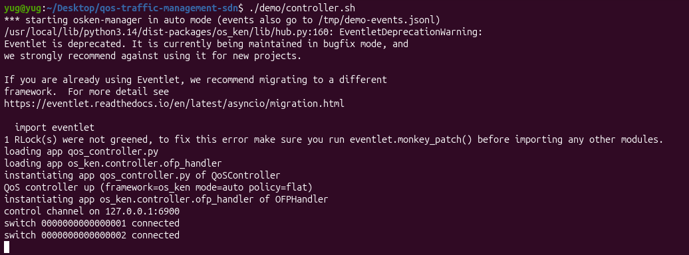 | 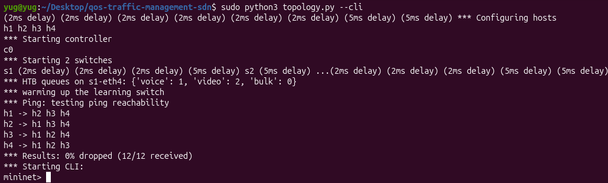 |
| The controller starts (mode auto, policy flat) and both switches connect. | Mininet builds the network, creates the queues and pings every host: 0% dropped. |

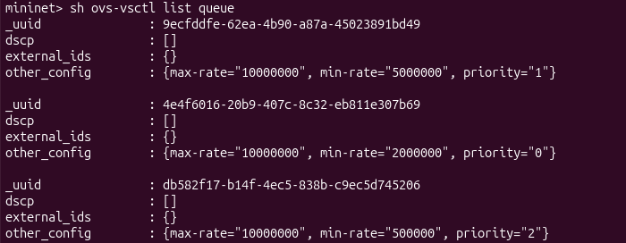

*The three queues on the slow link, with their guaranteed speed (min-rate) and priority.*

### Before and after congestion (the most important proof)

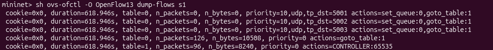

*Before: every traffic type is sent to `set_queue:0`, one shared queue.*

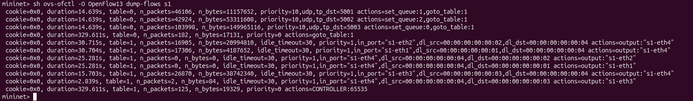

*After the controller detects congestion: voice (5001) goes to `set_queue:1`, video (5002) to `set_queue:2`, bulk (5003) stays in `set_queue:0`. Only these three rules changed.*

### Controlling it live

We can also change the policy while traffic is running, using `qosctl.py`, which talks to the controller over a TCP socket (port 6900).

| Command | What it does |
| --- | --- |
| `python3 qosctl.py status` | Shows the current policy, queues and how full the link is |
| `python3 qosctl.py policy flat` | Everyone shares one queue |
| `python3 qosctl.py policy qos` | Priority queues on |
| `python3 qosctl.py policy auto` | Let the controller decide by itself |
| `python3 qosctl.py set bulk 1` | Move bulk into voice's queue (shows the network decides priority, not the app) |
| `python3 qosctl.py events` | The controller's recent decisions |

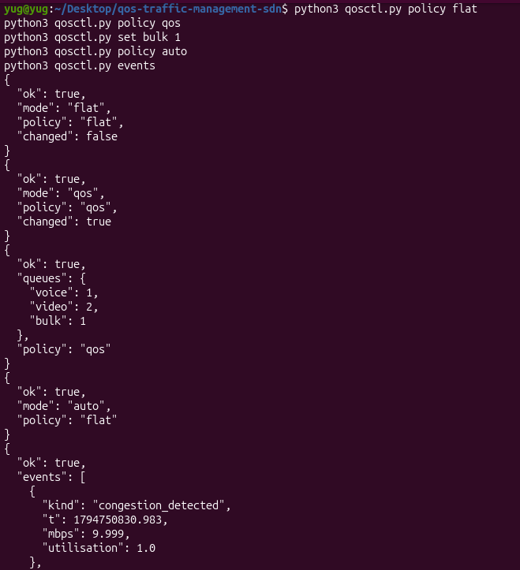

---

## 5. The socket programs

**Why UDP?** UDP does not slow down when the network is busy (TCP does). So congestion stays visible, which is exactly what we want to test.

- **Sender** (`udp_sender.py`): opens a UDP socket and sends packets at a fixed speed for one traffic type. It also marks each packet with a priority label in the IP header (DSCP).
- **Receiver** (`udp_receiver.py`): runs on h4 and listens on all three ports at once, using one thread per traffic type, so a busy type cannot block the others.

**What is inside each packet** (the first 15 bytes):

| Field | Why |
| --- | --- |
| Traffic type (1 = voice, 2 = video, 3 = bulk) | So the receiver knows which type it is |
| Sequence number | To find lost packets (gaps in the numbers) |
| Time sent | To calculate delay |
| Padding length | To check the packet arrived complete |

The rest of the packet is filler, to make it the right size (200 B voice, 1200 B video, 1400 B bulk).

**What we measure:**

| Measure | How | Unit |
| --- | --- | --- |
| Throughput | Data received ÷ time | Mbps |
| Packet loss | Missing sequence numbers ÷ expected | % |
| Delay (latency) | Time received − time sent | ms |
| Jitter | How much the delay changes from packet to packet | ms |

Delay can be measured one-way because all Mininet hosts run on the same computer and share one clock.

---

## 6. Setup and how to run

**Install (once), on Ubuntu 20.04 / 22.04 / 24.04:**

```bash
git clone https://github.com/Yug-Gajera/qos-traffic-management-sdn.git
cd qos-traffic-management-sdn
./setup.sh
```

**Check it works:**

```bash
sudo mn --test pingall    # 0% dropped
osken-manager --version   # 3.1.1
python3 test_qos.py       # all checks passed
```

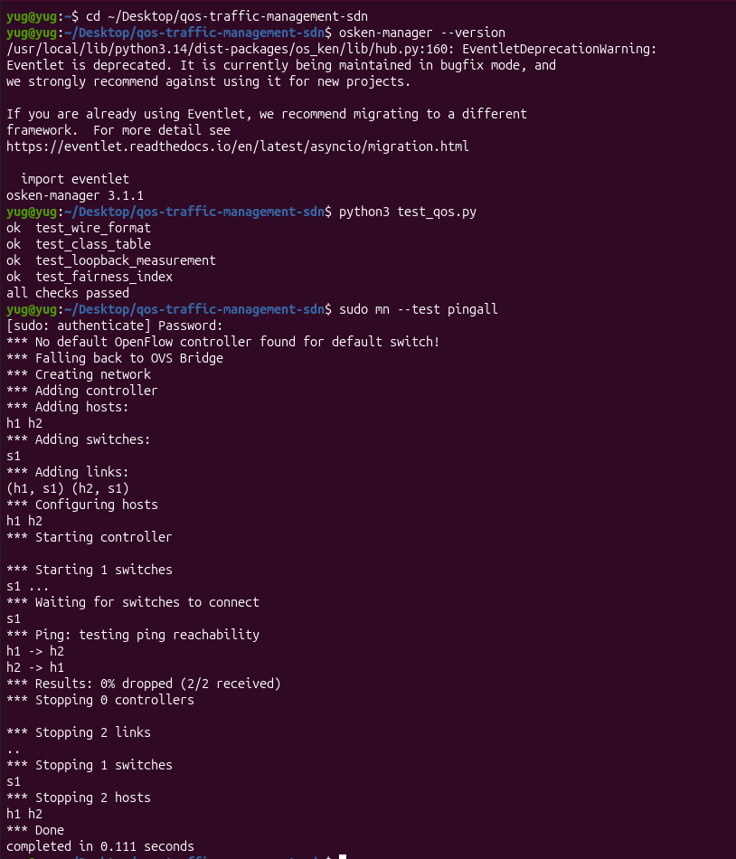

**Run the full experiment (about 2 minutes):**

```bash
pkill -f osken-manager    # stop any demo controller first
sudo ./run.sh             # baseline, dynamic and qos tests + analysis
cat results/report.md     # tables
xdg-open results/throughput.png
```

**Live demo (3 terminals, all in the project folder):**

| Terminal | Command | What you see |
| --- | --- | --- |
| 1 | `./demo/controller.sh` | Controller running; watch for congestion messages |
| 2 | `sudo python3 topology.py --cli` | Network starts, `mininet>` prompt |
| 3 | `./demo/check.sh` | Before: all traffic in queue 0 |
| 2 | `source demo/traffic.cli` | Voice and video start; bulk joins 15 s later |
| 3 | `./demo/check.sh` (after 20 s) | After: voice in queue 1, video in queue 2 |
| 2 | `sh cat /tmp/rx.log` (after 100 s) | Speed, loss, delay and jitter per type |

---

## 7. Tests we ran

**Three experiments, same traffic each time:** voice and video start at 0 s, bulk joins at 10 s (this causes the congestion), and each run lasts 30 s.

| Experiment | Policy | What it shows |
| --- | --- | --- |
| **Baseline** | flat (one shared queue) | What happens with no QoS |
| **Dynamic** | auto (controller decides) | The controller noticing congestion and switching by itself |
| **QoS** | qos (priority always on) | The best case |

**Test cases:**

| # | What we tested | Result |
| --- | --- | --- |
| T1 | Self-test of packet format and measurements | Passed |
| T2 | All hosts can reach each other | Passed (12/12) |
| T3 | The three queues exist | Passed |
| T4 | No congestion when bulk is off | Passed: in the first 10 s of every run, voice and video ran at full speed and the controller did nothing |
| T5 | Congestion without QoS | Voice and video lost about 47% |
| T6 | Congestion with QoS | Voice and video lost 0% |
| T7 | Controller reacts by itself | Passed: switched to QoS about 3 s after bulk joined |
| T8 | Change policy live | Passed (`policy flat` / `qos` / `auto`) |
| T9 | Move a traffic type live | Passed (`set bulk 1`) |
| T10 | Recovery when traffic stops | Passed: back to flat when the link dropped below 60% |

---

## 8. Results

**In one line:** with QoS, voice and video lost **0%** of packets with **2 ms** delay; without it, they lost **about 47%** with **about 360 ms** delay. Bulk paid the price.

Results from `sudo ./run.sh` on the course VM:

| Experiment | Traffic | Speed (Mbps) | Loss (%) | Avg delay (ms) | Jitter (ms) |
| --- | --- | ---: | ---: | ---: | ---: |
| Baseline | Voice | 0.262 | 46.97 | 369.93 | 1.69 |
| Baseline | Video | 1.519 | 47.59 | 360.09 | 0.89 |
| Baseline | Bulk | 8.723 | 54.07 | 1011.28 | 0.23 |
| Dynamic | Voice | 0.412 | 19.45 | 62.39 | 0.05 |
| Dynamic | Video | 2.815 | 6.18 | 40.76 | 0.06 |
| Dynamic | Bulk | 6.717 | 64.48 | 1447.99 | 0.58 |
| QoS | Voice | **0.512** | **0.00** | **2.16** | 0.03 |
| QoS | Video | **3.000** | **0.00** | **2.16** | 0.07 |
| QoS | Bulk | 6.289 | 66.74 | 1594.06 | 0.55 |

**What the numbers mean:**

- **Baseline:** everyone shares one queue, so everyone loses about half their packets. Voice calls and video would be unusable.
- **QoS:** voice and video get their full speed (0.512 and 3.0 Mbps), with no loss and almost no delay. Bulk takes all the loss.
- **Dynamic:** in between. Voice and video suffer for the first ~3 seconds after bulk joins, until the controller reacts. After that they are protected, like QoS.

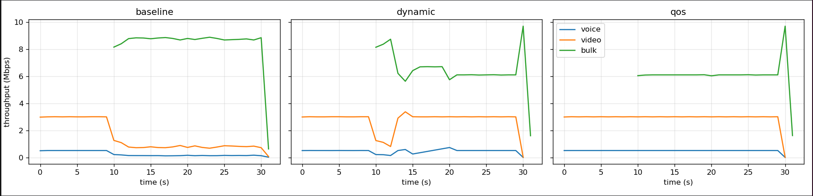

*Speed of each traffic type, second by second.*

- **Baseline:** at 10 s bulk joins and voice and video crash, and stay down.
- **Dynamic:** they crash at 10 s, then recover at about 13 s when the controller switches to QoS.
- **QoS:** voice and video never move.
- The bulk spike near 30 s is bulk's queue emptying after voice and video stop.

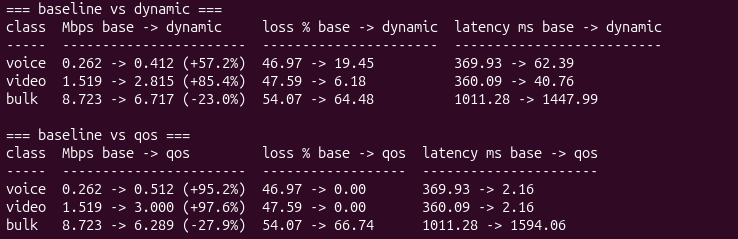

*The comparison printed by `analyze.py`: QoS raised voice and video speed by about 96% and cut their loss from about 47% to 0%.*

### Why are packets dropped?

Bulk sends 20 Mbps into a link that can only carry 10 Mbps. Its queue fills up (1,000 packets), and the switch throws away new packets that don't fit. QoS cannot stop drops when there is more traffic than the link can carry. It decides **who** gets dropped: bulk instead of voice and video.

### Fairness

We used **Jain's fairness index** (1.0 = everyone gets an equal share).

| Experiment | Fairness (raw speed) | Fairness (compared to what each asked for) |
| --- | ---: | ---: |
| Baseline | 0.469 | 0.995 |
| Dynamic | 0.620 | 0.878 |
| QoS | 0.656 | 0.851 |

- **Raw fairness goes up with QoS:** voice and video get their share instead of being pushed out by bulk.
- **The second index goes down, which looks odd.** In the baseline every type was treated *equally badly* (all lost about half), and this index counts that as "fair". So we judge by loss and delay, not by this number.

**Repeatability:** we ran the full experiment twice and got the same pattern both times. Only the dynamic numbers change a little between runs (voice loss 11% in one run, 19% in the other), depending on exactly when the controller's 2-second check happens after bulk joins.

---

## 9. Live demo evidence

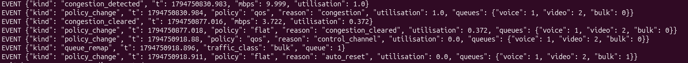

*The controller's log during the demo, line by line:*

- `congestion_detected`: link at 9.999 Mbps (100% full).
- `policy_change` to **qos**, 1 ms later.
- `congestion_cleared` and back to **flat** when the link dropped to 3.72 Mbps.
- The last three lines are our live commands: `policy qos`, `set bulk 1`, `policy auto`.

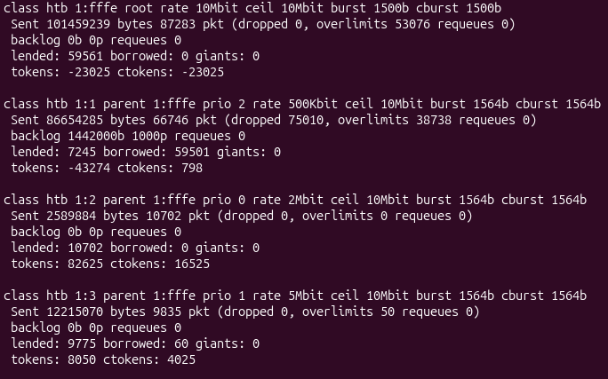

*Queue counters on the slow link during congestion:*

- **Voice** (class 1:2) and **video** (class 1:3) dropped **0** packets.
- **Bulk** (class 1:1) dropped **75,010** packets, and its queue was full (1,000 packets).
- Bulk still "borrowed" spare bandwidth, so the link was never wasted.


*The receiver's results from the live demo (auto mode): voice 3.1% loss and 18.7 ms delay, video 2.9% loss and 15.8 ms delay, while bulk lost 67%. The small voice and video loss happened in the few seconds before the controller reacted.*

---

## 10. Problems we found and fixed

While testing, we found five bugs in the code and fixed them all.

| # | Problem | Why it happened | Fix |
| --- | --- | --- | --- |
| 1 | Controller crashed at start | It used a Ryu class name (`RyuApp`) that OS-Ken calls `OSKenApp` | Use whichever name exists |
| 2 | Controller ignored the switches | Our variable `self.events` overwrote the framework's own internal variable with the same name | Renamed it to `self.event_log` |
| 3 | `run.sh` couldn't find the controller | `setup.sh` installed the newest OS-Ken (no `osken-manager` command), and only for one user | Install OS-Ken version 3, for the whole system |
| 4 | Congestion events missing from the report | `analyze.py` read them from the wrong file | Read them from the controller's log file |
| 5 | Graph showed bulk at the wrong time | Each traffic type had its own clock, so bulk was drawn from 0 s instead of 10 s | All types now share one clock |

---

## 11. Limitations and future work

**Limitations:**

- The controller checks the link every 2 s, so voice and video suffer for about 3 s before it reacts.
- It looks at total traffic on the link, so it can't tell which type caused the congestion.
- The design assumes this exact topology (which switch and port is the bottleneck).
- Everything runs in an emulated network on one computer; real switches and links may behave a little differently.

**Future work:**

- Check more often, or per traffic type, to react faster.
- Add a second path so bulk could be rerouted instead of slowed.
- Add more traffic types.

---

## 12. Conclusion

Our system does what the project asked: it creates three UDP traffic types, and when the network gets congested, the SDN controller automatically gives priority to voice and video. On the course VM this took their packet loss from about 47% to 0% and their delay from about 360 ms to 2 ms, while bulk absorbed the congestion. The policy can also be changed live, and it returns to normal by itself when congestion ends.

---

## Repository files

| File | What it does |
| --- | --- |
| `qos_proto.py` | Shared settings: the three traffic types and the packet format |
| `udp_sender.py` | Sends one traffic type at a fixed speed |
| `udp_receiver.py` | Receives all three types and measures speed, loss, delay and jitter |
| `qos_controller.py` | The SDN controller: flow rules, congestion detection, policy switching, control channel |
| `qosctl.py` | Sends commands to the controller (`status`, `policy`, `set`, `events`) |
| `topology.py` | Builds the Mininet network, creates the queues, runs the experiments |
| `analyze.py` | Turns results into tables, fairness numbers and the graph |
| `run.sh` | Runs the whole experiment with one command |
| `setup.sh` | Installs Mininet, Open vSwitch and OS-Ken 3 |
| `demo/` | Live-demo shortcuts: `controller.sh`, `traffic.cli`, `check.sh` |
| `test_qos.py` | Self-test (no root needed) |
| `docs/SRS.md` | Software requirements specification |
| `docs/images/` | Screenshots and diagrams used in this README |

## If something goes wrong

| Problem | Fix |
| --- | --- |
| `no ryu-manager/osken-manager found` | Run `./setup.sh` |
| `Address already in use` when starting the controller | A controller is already running: `pkill -f osken-manager` |
| Mininet crashed or won't start | `sudo mn -c`, then start again |
| `Permission denied` on `source demo/traffic.cli` | `sudo rm -f /tmp/rx.log /tmp/voice.log /tmp/video.log /tmp/bulk.log /tmp/demo.json` |
| `run.sh` results look wrong (voice losing packets under QoS) | The demo controller was still running: stop it and re-run |
| `sh ...` command not found in a normal terminal | `sh` is only for the `mininet>` prompt; in a normal terminal use `sudo` instead |
